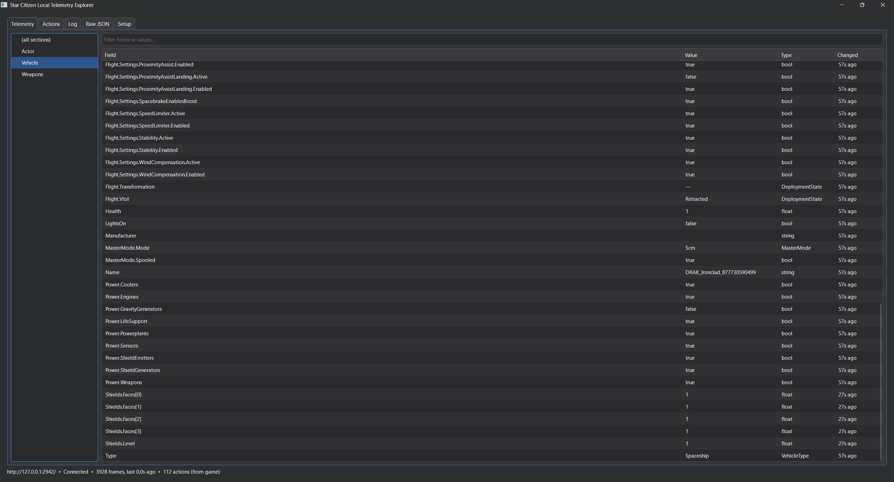

# Star Citizen Local Telemetry

An experimental, unofficial .NET library for the local gRPC telemetry service
built into Star Citizen. Stream vehicle, weapon, actor and event telemetry as plain
C# records, and discover and trigger in-game actions.

> Not affiliated with Cloud Imperium Games or Roberts Space Industries. The
> telemetry service is undocumented and may change with any game patch.

## Features

- **Telemetry stream**: C# records and enums for every section the game sends,
  with automatic reconnects, connection events and change detection.
- **Actions**: constants for every advertised action, discovery, and typed
  helpers such as `SetLightsAsync` and `SetLandingGearAsync`.
- **Setup**: find the game installation and enable telemetry for a channel.
- **Schema checks**: warns when the game sends data that the bundled schema
  doesn't describe, instead of silently dropping it.
- **App-friendly**: `ITelemetryClient` for testing, `ILogger` logging and
  `services.AddStarCitizenTelemetry()` for dependency injection.
- **Trim- and native-AOT-compatible** on .NET 11.

## Requirements

- .NET Core 3.0+ or .NET 5+ (the package targets `netstandard2.1` and `net11.0`).
  .NET Framework isn't supported: its HTTP stack can't connect to the game's
  unencrypted HTTP/2 endpoint.
- Windows, for the setup API and the game itself.
- A game build that has the telemetry service. The bundled schema was taken from
  `StarCitizen.exe` `5.0.202.10025` (PTU).

## Getting started

### 1. Enable telemetry in the game

The game needs the user environment variable `GRPC_CLIENT_SERVER_ENABLED=true` and
`server.game.telemetry.enabled = 1` in the channel's `user.cfg`. The library can set
both (it backs up `user.cfg` first):

```csharp
using StarCitizen.LocalTelemetry.Setup;

var result = await TelemetrySetup.EnableAsync("PTU");
if (result.RestartRequired)
    Console.WriteLine("Restart the RSI Launcher and the game.");
```

With the environment variable set, you can also toggle telemetry in-game with the
console command `server.game.telemetry.enabled 1` (or `0`), or use the Setup tab of the
[Telemetry Explorer](#samples). See [docs/setup.md](docs/setup.md).

### 2. Add the package

The package isn't on a NuGet feed yet. Download the `.nupkg` from a
[GitHub release](https://github.com/ROBdk97/star-citizen-local-telemetry/releases)
or build it yourself, then add the folder as a package source:

```powershell
dotnet pack .\src\StarCitizen.LocalTelemetry -c Release -o .\artifacts
dotnet nuget add source C:\path\to\artifacts --name local-telemetry
dotnet add package StarCitizen.LocalTelemetry --prerelease
```

### 3. Read telemetry

```csharp
using StarCitizen.LocalTelemetry;

using var client = new StarCitizenTelemetryClient(); // http://127.0.0.1:2942
using var stop = new CancellationTokenSource();
Console.CancelKeyPress += (_, e) => { e.Cancel = true; stop.Cancel(); };

await foreach (var vehicle in client.ReadTelemetryWithReconnectAsync(cancellationToken: stop.Token).Vehicles(stop.Token))
    Console.WriteLine($"{vehicle.Name}: lights={vehicle.LightsOn}, gear={vehicle.Flight?.LandingGear}");
```

`ReadTelemetryWithReconnectAsync` keeps retrying while the game isn't running, so
you can start your app first. Each frame contains only the sections the game sent;
missing ones are `null`. For connection status, use `ObserveTelemetryAsync`; for
only changed sections, `ObserveChanges()`. See
[docs/telemetry.md](docs/telemetry.md) for the stream behaviour and every field.

### 4. Trigger actions

On LIVE `4.10.3-live.13220821`, telemetry can be read but actions cannot be
triggered. The bundled action catalog comes from PTU.

```csharp
// Actions change the game. Only send them in response to a user request.
var result = await client.SetLightsAsync(true, stop.Token);
await client.SetMasterModeAsync(MasterMode.Navigation, stop.Token);
await client.TriggerKnownActionAsync(GameActions.LightsController.LightsOff, cancellationToken: stop.Token);
Console.WriteLine(result.IsSuccess ? "OK" : $"{result.Status}: {result.Message}");
```

Actions are never retried: after a transport failure it's unknown whether the
game applied them. See [docs/actions.md](docs/actions.md) for all actions, helpers
and result semantics.

## Using it in an app

Register the client with dependency injection; it logs through
`ILogger<StarCitizenTelemetryClient>`:

```csharp
services.AddLogging();
services.AddStarCitizenTelemetry(options =>
{
    options.Address = new Uri("http://127.0.0.1:2942");
    options.RetryDelay = TimeSpan.FromSeconds(5);
});
```

This registers one client as both `StarCitizenTelemetryClient` and
`ITelemetryClient`. Without DI, use `new StarCitizenTelemetryClient(options, logger)`.
The client logs connects and disconnects (Information), connection attempts and
actions (Debug), and schema mismatches (Warning).

Depend on `ITelemetryClient` to use a fake in your tests. The reconnect, filter and
action helpers are extension methods on the interface, so they work with a fake too.

## Schema checks

After a patch the game may add or change fields. The client compares every
response with the bundled schema and reports each distinct difference once, as a
`SchemaMismatch` (`UnknownField`, `UnknownEnumValue` or `ChangedFieldType`, with the
field path):

- logged as a warning,
- yielded as a `SchemaMismatch` event from `ObserveTelemetryAsync`,
- listed in `client.SchemaMismatches`.

Set `DetectSchemaMismatches = false` in the options to turn this off.
`TelemetrySchema.CheckGameVersion(channel)` compares an installed game's version
with the one the schema was taken from; a different version doesn't necessarily
mean a different schema. To update the schema, see [tools/README.md](tools/README.md).

## Samples

- [`samples/TelemetryExplorer`](samples/TelemetryExplorer/README.md): a Windows
  desktop app that shows every telemetry field, triggers any advertised action,
  and enables or disables telemetry for an installed channel.
- `samples/TelemetryMonitor`: a minimal read-only console app.



```powershell
dotnet run --project .\samples\TelemetryExplorer
dotnet run --project .\samples\TelemetryMonitor
```

## Security

The game's endpoint is unencrypted and unauthenticated, and it can trigger
gameplay actions. Keep it on the loopback address (`127.0.0.1`).

## Documentation

- [docs/setup.md](docs/setup.md): finding the game and enabling telemetry.
- [docs/telemetry.md](docs/telemetry.md): stream behaviour, models and fields.
- [docs/actions.md](docs/actions.md): actions, helpers and trigger semantics.
- [tools/README.md](tools/README.md): updating the schema and actions after a patch.
- [CHANGELOG.md](CHANGELOG.md): release notes.
- All public types and members have XML documentation.

## Contributing

```powershell
dotnet build .\StarCitizen.LocalTelemetry.slnx -c Release
dotnet test --solution .\StarCitizen.LocalTelemetry.slnx -c Release
```

The tests use a fake service and never touch the game. See
[CONTRIBUTING.md](CONTRIBUTING.md) for the format check, public API files, schema
updates and releases.

## Versioning

Versions follow [SemVer](https://semver.org) and come from git tags (`v0.2.0` →
`0.2.0`); untagged builds are `0.0.0-preview.0`. The library version is independent
of the game version. While on `0.x`, a minor version may contain breaking changes,
and a patch only refreshes the schema or actions or fixes bugs. Releases whose
schema exists only on the PTU are prereleases (`-preview.N`).